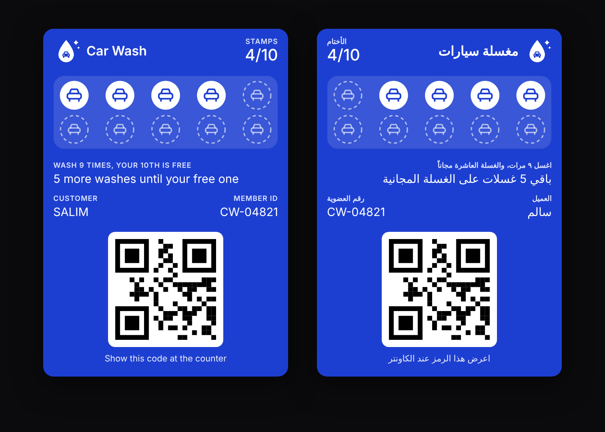

# Car wash loyalty card (Apple Wallet)

A stamp card that lives in Apple Wallet and updates itself. Design follows the
`Car_Wash_Loyalty_Card_Sample.pdf` brief: Wash Blue `#1D3FD1`, droplet + car mark,
10 stamp slots, "Wash 9 times, your 10th is free", English and Arabic.



## How it works

1. **Customer** opens the sign-up page (`/`), types name + phone, taps *Add to Apple Wallet*.
   Put this link in a QR code poster at the counter, the Instagram bio, or WhatsApp.
2. **Staff** opens `/staff` on any phone, logs in with the PIN, scans the card's QR
   (or types the member ID) and taps **+1 stamp**. At 9 stamps the button changes to
   **Give free wash**, which resets the card.
3. The server pushes a silent notification to Apple. The customer's iPhone downloads the
   new pass within seconds, the stamp appears, and the lock screen shows
   "You now have 5/10 stamps". No app needed.

The pass shows in Arabic on phones set to Arabic (labels, text, and right-to-left stamp order).

## What's in here

| Path | What it does |
|---|---|
| `src/server.js` | HTTP server: sign-up, staff API, and the Apple Wallet web service (`/wallet/v1/...`) |
| `src/pass.js` | Builds `pass.json`, EN/AR strings, manifest, PKCS#7 signature, `.pkpass` zip |
| `src/art.js` | Draws icon, logo and stamp strip (0–9 stamps, LTR + RTL) as PNG |
| `src/apns.js` | Push to Apple (HTTP/2, pass certificate as client cert) |
| `src/db.js` | SQLite (built into Node 22): members, devices, stamp log |
| `public/join.html`, `public/staff.html` | Customer and staff pages |
| `scripts/sample-pass.js` | Build one sample pass without the server |
| `scripts/preview.js` | Render a mockup of the pass to `out/preview.html` |

## Setup

Needs Node 22+.

```bash
npm install
cp config.example.json config.json   # fill in business details, Apple IDs, URL, PIN
```

### 1. Apple certificate (needs an Apple Developer account, $99/yr)

1. developer.apple.com → Certificates, IDs & Profiles → Identifiers → **+** → **Pass Type IDs**
   → e.g. `pass.om.carwash.loyalty`.
2. Open it → **Create Certificate** → upload a CSR (Keychain Access → Certificate Assistant →
   Request a Certificate from a CA → saved to disk) → download `pass.cer`.
3. Double-click `pass.cer`, then in Keychain export it with its key as `pass.p12`.
4. Download Apple's WWDR G4 intermediate: https://www.apple.com/certificateauthority/AppleWWDRCAG4.cer
5. Put both in `certs/` and set in `config.json`:
   `passTypeIdentifier`, `teamIdentifier` (10 chars, top-right of the developer site),
   `p12`, `p12Password`, `wwdr`.

No Mac? Make the CSR with OpenSSL instead and use PEM files:

```bash
openssl req -new -newkey rsa:2048 -nodes -keyout certs/pass.key -out pass.csr -subj "/CN=Car Wash Pass"
# upload pass.csr, download pass.cer, then in config.json:
#   "certPem": "certs/pass.cer", "keyPem": "certs/pass.key"   (instead of p12)
```

### 2. Host it

Wallet only talks to **HTTPS** with a valid certificate. Any small Node host works
(Render, Railway, Fly.io, a VPS behind Caddy). Keep `data/` on a persistent disk.

```bash
PUBLIC_URL=https://loyalty.yourdomain.com STAFF_PIN=xxxx NODE_ENV=production node src/server.js
```

`PUBLIC_URL` is baked into every pass, so pick the final domain before giving out cards.
Changing the Pass Type ID or URL later means customers must re-add the card.

### Try it locally without Apple

```bash
./scripts/make-test-certs.sh
# point apple.certPem / keyPem / wwdr at certs/test/*.pem in config.json
node scripts/sample-pass.js 4      # out/sample.pkpass (iPhone will refuse the test signature)
node scripts/preview.js 4          # out/preview.html
node src/server.js
```

## Notes

- One card per phone number. Joining again with the same number re-downloads the same card.
- Staff login is locked for 10 minutes after 5 wrong PINs.
- Stamp count, member list and the event log are in `data/loyalty.db` (back it up).
